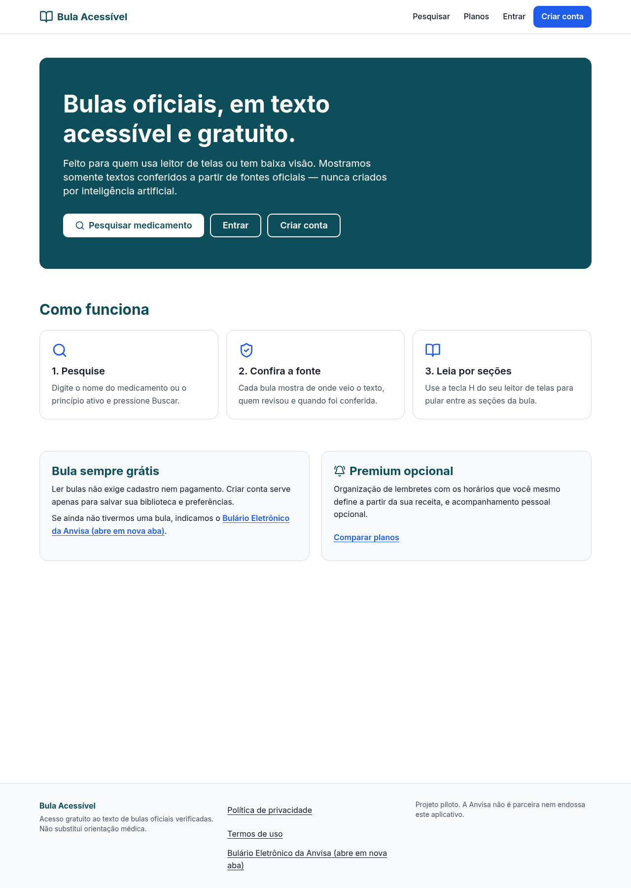
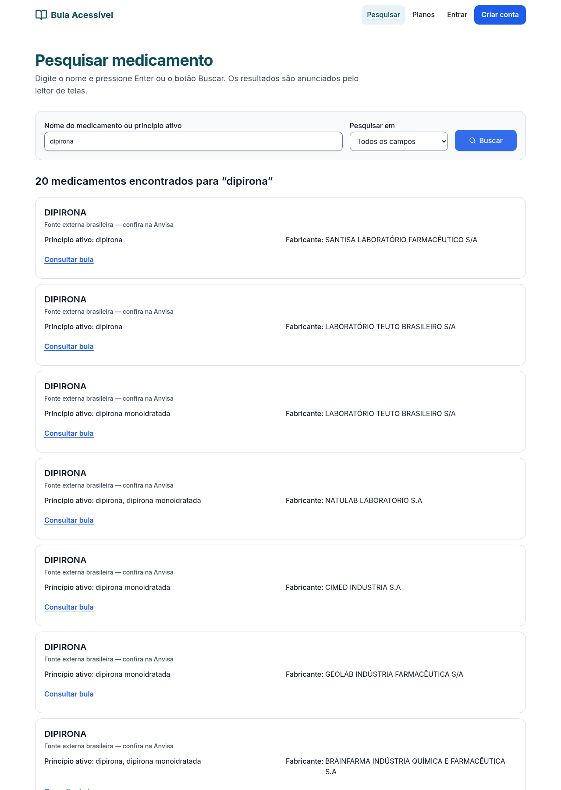
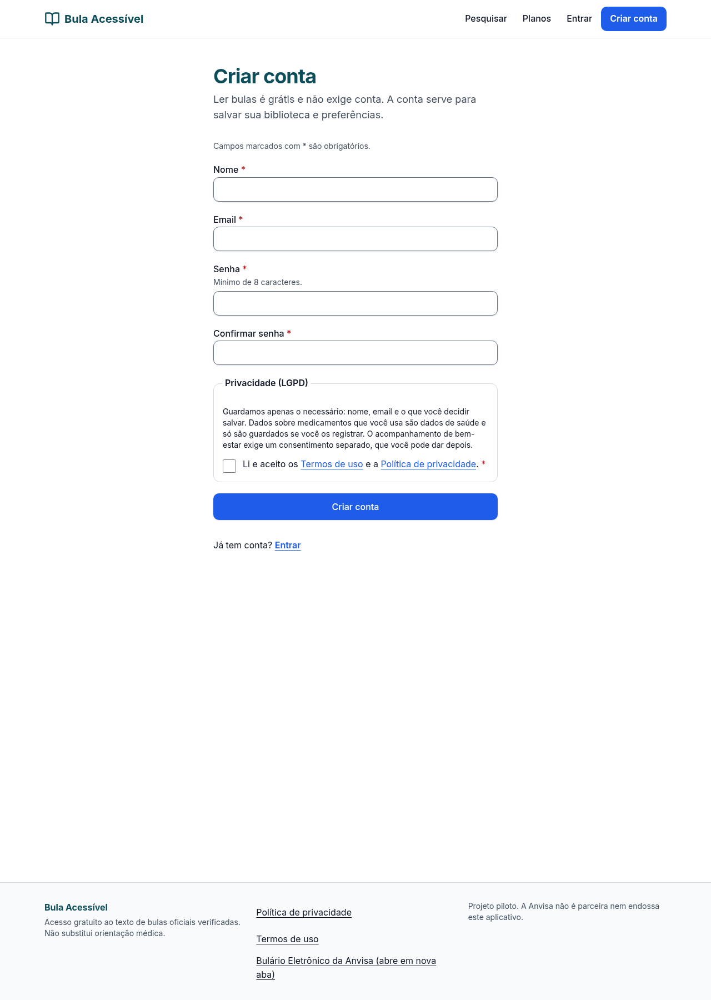
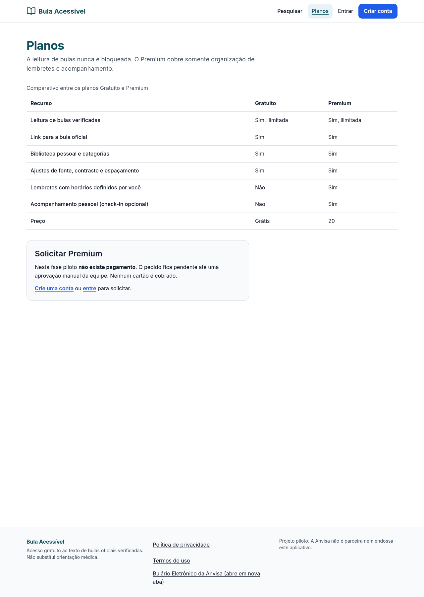
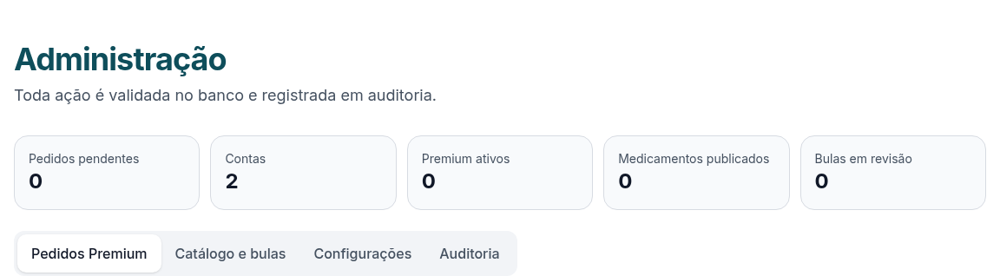

# Bula Acessível — MVP piloto

> **Status da entrega DIO: documentação atualizada; GitHub público bloqueado até remover `.env` do rastreamento e concluir a revisão de segurança. Publicação pública e repositório continuam pendentes.**
>
> A prévia técnica não é apresentada como um site público publicado. Não há receita, cobrança, certificação de acessibilidade ou validação clínica automatizada declarada neste documento.

Acesso gratuito e acessível ao texto de bulas, com foco em pessoas cegas ou com baixa visão. O Bula Acessível combina catálogo local curado, pesquisa em uma fonte brasileira independente e fallback internacional claramente identificado. A hipótese de monetização é restrita à organização de lembretes e check-ins opcionais: **ler bulas nunca fica atrás de pagamento**.

## Sumário

1. [Links e situação da entrega](#1-links-e-situação-da-entrega)
2. [Problema e proposta de valor](#2-problema-e-proposta-de-valor)
3. [Personas prioritárias](#3-personas-prioritárias)
4. [Oportunidade e tamanho de mercado](#4-oportunidade-e-tamanho-de-mercado)
5. [Business Model Canvas](#5-business-model-canvas)
6. [Tese do MVP e validação](#6-tese-do-mvp-e-validação)
7. [O que existe e o que continua manual](#7-o-que-existe-e-o-que-continua-manual)
8. [Arquitetura e segurança](#8-arquitetura-e-segurança)
9. [Prova do MVP](#9-prova-do-mvp)
10. [Mega prompt e correções posteriores](#10-mega-prompt-e-correções-posteriores)
11. [Evidências visuais](#11-evidências-visuais)
12. [Como executar e testar](#12-como-executar-e-testar)
13. [Checklist público da DIO e do GitHub](#13-checklist-público-da-dio-e-do-github)

## 1. Links e situação da entrega

| Item                             | Endereço ou situação verificada                                                                                        |
| -------------------------------- | ---------------------------------------------------------------------------------------------------------------------- |
| Prévia técnica                   | https://id-preview--d592b9a3-9603-4e50-a858-a23efcda8ec5.lovable.app/                                                  |
| Editor do projeto                | https://lovable.dev/projects/d592b9a3-9603-4e50-a858-a23efcda8ec5                                                      |
| Aplicação publicada              | **Pendente.** A consulta ao projeto indicou `is_published=false` e nenhum `published_url`.                             |
| Repositório público              | **Pendente.** Não foi localizado um repositório do Bula Acessível entre os repositórios acessíveis da conta informada. |
| Nome sugerido para o repositório | `bula-acessivel` ou `bula-acessivel-mvp`, sem maiúsculas ou acentos. Nenhum repositório foi criado nesta tarefa.       |
| Especificação inicial            | [Mega prompt integral](docs/MEGA_PROMPT.md)                                                                            |
| Documentação técnica             | [Arquitetura, banco, rotas, segurança e NVDA](docs/ARQUITETURA.md)                                                     |

**Importante:** a URL de prévia pode exigir o contexto do Lovable e não substitui a URL pública exigida para a entrega final. Publicação e criação de repositório não foram executadas.

## 2. Problema e proposta de valor

### Dor escolhida

Pessoas cegas, com baixa visão ou com outras dificuldades de leitura frequentemente dependem de bulas em papel ou de documentos pouco navegáveis. Isso pode transformar uma tarefa essencial — encontrar uma informação na bula — em uma atividade dependente de terceiros.

A dor priorizada é **a falta de autonomia para pesquisar e ler uma bula por teclado e leitor de telas**, sem abrir mão da proveniência do conteúdo.

### Proposta

- Pesquisa pública sem cadastro.
- Texto navegável por títulos, seções, links e controles nativos.
- Preferências de fonte, contraste e espaçamento.
- Fonte e data de conferência visíveis quando há curadoria local.
- Separação explícita entre conteúdo local verificado e conteúdo externo não validado.
- Nenhuma geração, tradução, conclusão ou complementação clínica por IA.
- Biblioteca pessoal e categorias sem interpretar consulta como uso de medicamento.
- Lembretes com horários informados pela própria pessoa, conforme sua prescrição, nunca sugeridos pelo aplicativo.

### Viabilidade de negócio

A viabilidade é uma **hipótese a validar**, não um resultado comprovado. O acesso gratuito reduz a barreira de entrada e preserva a missão social; uma eventual assinatura de organização pessoal poderia contribuir para custos de infraestrutura, provedores de dados e canais de notificação. A disposição real a pagar, o custo de aquisição e a retenção ainda não foram medidos.

O modelo também depende de licenciamento e estabilidade das fontes, revisão humana e controles de segurança para dados sensíveis de saúde. O faturamento do mercado farmacêutico não comprova demanda nem receita para este software.

## 3. Personas prioritárias

| Pessoa                                          | Necessidade central                                                 | Resposta do MVP                                                                        |
| ----------------------------------------------- | ------------------------------------------------------------------- | -------------------------------------------------------------------------------------- |
| Pessoa cega que usa NVDA no Windows/Chrome      | Pesquisar, identificar e percorrer a bula sem auxílio               | HTML semântico, títulos, regiões, foco visível, controles nativos e anúncios de estado |
| Pessoa com baixa visão                          | Ampliar e ajustar a leitura                                         | Controles de fonte, contraste e espaçamento                                            |
| Pessoa idosa ou com pouca familiaridade digital | Encontrar informação sem navegação complexa                         | Fluxo direto, textos claros e ações explícitas                                         |
| Cuidador ou familiar                            | Consultar a fonte e organizar informações sem presumir uso          | Biblioteca e estados distintos de consulta, salvamento e uso                           |
| Curador ou administrador do piloto              | Publicar somente após revisão e tratar pedidos sem simular cobrança | Curadoria, permissões no banco, confirmação e auditoria                                |

As personas são recortes de produto; não representam pesquisa de usuários concluída.

## 4. Oportunidade e tamanho de mercado

### Dados de contexto, com fontes

- O **IBGE, Censo 2022**, em resultados preliminares divulgados em maio de 2025, informou **14,4 milhões de pessoas com deficiência** no Brasil. Dessas, **7,9 milhões tinham dificuldade funcional para enxergar**. Esse número **não significa 7,9 milhões de pessoas cegas**. Fonte: [Agência Gov — Censo 2022 e deficiência](https://agenciagov.ebc.com.br/noticias/202505/censo-2022-brasil-tem-14-4-milhoes-de-pessoas-com-deficiencia).
- A **Anvisa/CMED**, na edição 2025 do anuário divulgada em setembro de 2026, informou aproximadamente **R$ 182 bilhões de faturamento na venda de medicamentos em 2025** e **6,3 bilhões de embalagens**. Fonte: [Anvisa — 9ª edição do Anuário Estatístico do Mercado Farmacêutico](https://www.gov.br/anvisa/pt-br/assuntos/noticias-anvisa/2026/cmed-divulga-9deg-edicao-do-anuario-estatistico-do-mercado-farmaceutico).

Os dados indicam relevância social e intensidade de uso de medicamentos, mas **não são uma estimativa de receita para software acessível**.

### TAM, SAM e SOM sem números inventados

| Recorte                                    | Aproximação possível                                                                                    | Limitação                                                                                                                |
| ------------------------------------------ | ------------------------------------------------------------------------------------------------------- | ------------------------------------------------------------------------------------------------------------------------ |
| TAM de pessoas potencialmente beneficiadas | Os 7,9 milhões com dificuldade funcional para enxergar são uma referência de contexto                   | Não representa todas as pessoas cegas, não inclui todo o público secundário e não mede acesso digital ou intenção de uso |
| SAM                                        | Parcela do recorte com acesso digital, necessidade de consultar bulas e alcance pelos canais do projeto | **Não quantificado:** exige pesquisa de acesso, comportamento e canais                                                   |
| SOM                                        | Pessoas alcançadas pelo piloto que concluem pesquisa e leitura e permanecem ativas                      | **Não quantificado:** depende de uma coorte real e de período de observação                                              |
| Mercado adjacente                          | Venda de medicamentos no Brasil                                                                         | Os R$ 182 bilhões não são TAM do Bula Acessível nem base direta para projeção de assinatura                              |

### Hipóteses comerciais a testar

1. A leitura gratuita gera confiança e uso recorrente.
2. Uma parcela dos usuários ativos terá interesse em organizar lembretes e check-ins.
3. Parcerias com organizações de acessibilidade, farmácias ou serviços de saúde podem reduzir o custo de descoberta do produto.
4. O valor percebido do Premium poderá cobrir custos variáveis sem restringir a leitura.

Não foram inventadas taxas de conversão, quantidade de clientes, receita, pesquisas ou projeções financeiras.

## 5. Business Model Canvas

| Bloco                              | Desenho atual                                                                                                                                                                                                                                    |
| ---------------------------------- | ------------------------------------------------------------------------------------------------------------------------------------------------------------------------------------------------------------------------------------------------ |
| **1. Segmentos de clientes**       | Primário: pessoas cegas ou com baixa visão. Secundário: idosos, cuidadores e pessoas que precisam de conteúdo acessível. Possíveis apoiadores institucionais: organizações de acessibilidade e serviços de saúde, ainda sem parceria confirmada. |
| **2. Proposta de valor**           | Autonomia para pesquisar e ler bulas em interface acessível, gratuita e com proveniência explícita. Organização pessoal opcional sem orientação clínica automatizada.                                                                            |
| **3. Canais**                      | Aplicação web, busca pública, Bulário oficial como referência, divulgação orgânica e futuras parcerias. Canais de aquisição ainda não validados.                                                                                                 |
| **4. Relacionamento com clientes** | Autoatendimento acessível, preferências persistentes, suporte humano no piloto e escuta com usuários de leitores de tela. Não há promessa de atendimento clínico.                                                                                |
| **5. Fontes de receita**           | Hipótese freemium: consulta e biblioteca gratuitas; possível cobrança futura por lembretes e check-ins. No piloto há apenas solicitação e aprovação manual, **sem pagamento real**.                                                              |
| **6. Recursos-chave**              | Aplicação web, banco PostgreSQL, autenticação e permissões, fontes de dados, curadoria humana, componentes acessíveis e documentação de segurança.                                                                                               |
| **7. Atividades-chave**            | Curadoria, manutenção de adapters, testes de acessibilidade, segurança/LGPD, suporte, observação de métricas e validação com usuários.                                                                                                           |
| **8. Parcerias-chave**             | Provedor brasileiro independente, openFDA como fallback internacional, Lovable Cloud e futuros provedores de notificação. Anvisa é referência oficial, **não parceira nem patrocinadora**.                                                       |
| **9. Estrutura de custos**         | Hospedagem e banco, chamadas e planos de APIs, licenciamento de dados, curadoria, desenvolvimento, testes assistivos e futuros envios de e-mail/push. Custos reais ainda não consolidados.                                                       |

### Concorrência e riscos

- **Alternativas atuais:** Bulário Eletrônico, PDFs oficiais, leitores de PDF, amplificadores e aplicativos genéricos de lembretes. O Bulário é a referência oficial e não deve ser descrito como integração parceira.
- **Risco de conteúdo:** indisponibilidade, mudança de schema, licença de uso ou defasagem das fontes.
- **Risco clínico:** interpretação inadequada de dados externos ou confusão entre apresentações de medicamentos.
- **Risco de acessibilidade:** uma interface visualmente simples ainda pode falhar com teclado ou leitor de telas; teste humano continua necessário.
- **Risco econômico:** limites e preços de APIs e notificações podem inviabilizar a hipótese freemium.
- **Risco de privacidade:** medicamentos em uso e check-ins são dados sensíveis de saúde e exigem minimização, consentimento e controle de acesso.

## 6. Tese do MVP e validação

### Tese principal

Uma pessoa cega ou com baixa visão consegue **pesquisar um medicamento, compreender a origem do resultado e abrir o texto disponível usando apenas teclado e leitor de telas**, sem depender de outra pessoa e sem que o sistema invente conteúdo clínico.

### Tese secundária

Depois de obter valor na leitura gratuita, parte dos usuários demonstrará interesse em salvar horários definidos por sua prescrição e registrar check-ins opcionais. Esse interesse ainda não valida preço nem pagamento.

### Métricas planejadas, sem resultados inventados

| Hipótese                | Como medir                                                                                       |
| ----------------------- | ------------------------------------------------------------------------------------------------ |
| Autonomia na tarefa     | Conclusão de pesquisa e abertura da bula sem ajuda, em sessão observada                          |
| Navegação compreensível | Uso de títulos, regiões e links; pontos de bloqueio e retorno de foco                            |
| Confiança na fonte      | Capacidade de distinguir conteúdo curado, fonte brasileira independente e conteúdo internacional |
| Valor recorrente        | Retorno e repetição da tarefa em uma coorte real                                                 |
| Interesse no Premium    | Solicitações espontâneas e entrevistas sobre utilidade, separadas de pagamento                   |
| Segurança percebida     | Compreensão dos consentimentos, exportação e exclusão de dados                                   |

**Validação com usuários finais e teste com NVDA real ainda estão pendentes.** A captura de uma busca funcional não comprova a tese de autonomia.

## 7. O que existe e o que continua manual

| Recurso                                      | Situação real                                                                                            |
| -------------------------------------------- | -------------------------------------------------------------------------------------------------------- |
| Pesquisa pública                             | Implementada no catálogo local e em fontes externas, com lista unificada e proveniência                  |
| Fonte brasileira                             | Integração real com `medicamentos.api.br`; não é API oficial da Anvisa                                   |
| Fallback internacional                       | openFDA implementado, em inglês, com aviso de que não é bula aprovada no Brasil                          |
| Leitura estruturada pelo provedor brasileiro | Implementada, mas pode exigir plano Pro/Business do fornecedor; não foi comprovada ao vivo nesta entrega |
| Catálogo local verificado                    | Curadoria humana e publicação protegida; nenhum medicamento fictício pré-cadastrado                      |
| Conta, biblioteca e preferências             | Implementados com banco e regras de acesso                                                               |
| Premium                                      | Pedido, aprovação/rejeição e entitlement manual; sem gateway, cobrança ou compra concluída               |
| Lembretes                                    | Agenda e horários do usuário persistidos; e-mail e push **não entregues**                                |
| Check-ins                                    | Opcionais, com consentimento e mensagem neutra; não geram diagnóstico nem recomendação                   |
| Acessibilidade                               | WCAG 2.2 AA como meta de projeto, **não certificação**; NVDA real pendente                               |
| Exportação e exclusão                        | Disponíveis nas configurações da conta                                                                   |

### Manual deliberadamente

- Extração e colagem de texto de PDF oficial para revisão humana; não há automação de importação apresentada como pronta.
- Publicação de bulas locais somente após curadoria e aprovação.
- Concessão da role administrativa por operação controlada no banco, sem admin automático.
- Aprovação de pedidos Premium sem pagamento no piloto.
- Horários sempre informados pelo usuário; nenhuma dose ou horário sugerido.
- Configuração futura de canais externos de notificação.
- Testes com NVDA, VoiceOver e pessoas usuárias reais.

## 8. Arquitetura e segurança

A stack usa React, TypeScript, TanStack Start, Tailwind, shadcn/ui e Lovable Cloud com PostgreSQL, autenticação e RLS. As buscas externas acontecem no servidor; a chave brasileira não é enviada ao navegador.

A documentação completa de rotas, tabelas, adapters, permissões, comandos e checklist assistivo está em [docs/ARQUITETURA.md](docs/ARQUITETURA.md).

### Regras inegociáveis

- Zero geração, tradução ou inferência de conteúdo médico por IA.
- Texto externo permanece separado, verbatim e explicitamente não validado.
- Nenhum resultado externo é salvo automaticamente como bula curada ou medicamento em uso.
- Links rotulados “Anvisa” só usam endereços oficiais permitidos.
- RLS e funções privilegiadas no banco protegem dados pessoais e ações administrativas.
- Dados de medicamentos e check-ins são tratados como dados sensíveis de saúde.
- Não há termos de saúde em query params nem cache compartilhado das respostas de busca.

### Segredos e versionamento

- `MEDICAMENTOS_API_KEY` está configurado como segredo do projeto e é lido apenas no servidor.
- `RESEND_API_KEY` **não está configurado e não há integração Resend implementada**. Se for usado futuramente, deverá ser adicionado somente em **Project Settings → Secrets**.
- [.env.example](.env.example) contém somente nomes de variáveis, sem valores.
- **Classificação local de 16 de novembro de 2026:** `.env` contém 6 variáveis não vazias, todas classificadas como configuração pública de execução; nenhuma credencial foi identificada. Nenhum nome de projeto, URL ou valor foi reproduzido nesta documentação.
- **Histórico:** foi encontrada 1 versão de `.env`, também sem credenciais pela mesma classificação. Uma varredura local de marcadores de alta confiança em 61 commits e 285 blobs únicos não encontrou candidatos a segredo; os 148 arquivos atualmente rastreados também foram verificados. Essa varredura não substitui o secret scanning do GitHub.
- **Bloqueio atual:** `.env` continua rastreado. A plataforma recusou a edição de `.gitignore`, e esta tarefa não alterou o índice Git nem reescreveu histórico. Antes de sincronizar um repositório público, o proprietário precisa adicionar `.env`, `.env.*`, `!.env.example`, `.dev.vars` e `.dev.vars.*` ao `.gitignore` por uma edição permitida e executar `git rm --cached .env`, que mantém o arquivo local. A confirmação deve ser feita com `git ls-files .env`: o resultado esperado é vazio. Depois, deve executar secret scanning no repositório conectado.
- Nenhuma credencial versionada foi identificada pela varredura descrita. Se uma verificação posterior encontrar uma credencial real no histórico, `.gitignore` não será suficiente: será necessário revogar/rotacionar a credencial e planejar a limpeza do histórico, sem reescrita destrutiva automática.

## 9. Prova do MVP

### Evidência funcional registrada em 16 de novembro de 2026

- Uma busca ao vivo por **“dipirona”** na prévia retornou **20 medicamentos reais exibidos** da fonte brasileira independente. A captura está em [02-busca-dipirona.png](docs/screenshots/02-busca-dipirona.png).
- Em uma execução anterior registrada, o backend informou 172 registros totais; a interface retorna 20 por página. Esse total representa registros do provedor, não usuários nem alcance de mercado. A captura desta entrega comprova os 20 itens exibidos, não uma nova medição do total.
- O painel administrativo foi aberto com a conta autorizada e capturado somente até os números agregados, sem nomes, e-mails ou pedidos pessoais. Nenhuma aprovação, rejeição, criação de pedido ou alteração de dados foi executada.
- **28 testes automatizados passaram** em quatro arquivos, cobrindo regras, rotas e normalização/falhas de provedores. Testes com mocks não substituem testes ao vivo nem auditoria assistiva.

### O que a prova não demonstra

- Não comprova publicação pública.
- Não comprova leitura Pro/Business da bula brasileira.
- Não comprova entrega de e-mail ou push.
- Não comprova pagamento, receita ou conversão.
- Não comprova conformidade WCAG nem sucesso com NVDA real.

## 10. Mega prompt e correções posteriores

O texto da primeira mensagem foi recuperado integralmente do histórico e está em [docs/MEGA_PROMPT.md](docs/MEGA_PROMPT.md). **É uma transcrição, não uma reconstrução.** O documento preserva a especificação original, inclusive requisitos que permanecem pendentes.

Em síntese, o prompt pediu um MVP full-stack em português, com autenticação, banco e permissões; busca e leitura acessíveis; biblioteca; lembretes e check-ins sem orientação clínica; backoffice; LGPD; WCAG 2.2 AA como meta; e a regra central de zero alucinação médica.

### Cronologia das iterações

| Ordem | Problema encontrado                                             | Correção solicitada                                            | Solução registrada                                                                                        | Status       |
| ----- | --------------------------------------------------------------- | -------------------------------------------------------------- | --------------------------------------------------------------------------------------------------------- | ------------ |
| 1     | A busca consultava apenas o banco local, ainda sem medicamentos | Implementar pesquisa real na internet, sem dados fictícios     | Adapter brasileiro, fallback openFDA, validação, timeout, avisos e rota externa                           | Implementado |
| 2     | Fontes externas precisavam de separação e identificação         | Não apresentar provedor independente ou FDA como Anvisa        | Proveniência, texto externo verbatim, avisos e proibição de salvamento automático como curado             | Implementado |
| 3     | A prévia não enxergava a chave recém-configurada                | Diagnosticar o ambiente sem expor o segredo                    | Leitura server-side confirmada, prévia atualizada/reiniciada e busca “dipirona” comprovada                | Resolvido    |
| 4     | Resultados separados e textos técnicos prejudicavam a leitura   | Criar lista única simples sem remover avisos essenciais        | Lista estável, proveniência concisa, total anunciado e diagnóstico recolhido                              | Implementado |
| 5     | O piloto precisava de administração controlada                  | Bootstrap seguro, revisão de pedidos e auditoria, sem cobrança | Role via banco, RLS/RPC, filtros, confirmação acessível, motivo de rejeição e proteção contra duplicidade | Implementado |

As linhas resumem os pedidos de correção; não são apresentadas como transcrições literais.

## 11. Evidências visuais

Todas as imagens abaixo são capturas autênticas da prévia, obtidas em 16 de novembro de 2026. Não foram usadas imagens geradas ou telas ilustrativas. A captura administrativa é um recorte real que termina antes da área de pedidos pessoais; seus números são apenas o estado agregado no instante da captura, não KPIs de negócio.

### Página inicial

[Abrir imagem](docs/screenshots/01-pagina-inicial.png)



### Busca real por “dipirona”

[Abrir imagem](docs/screenshots/02-busca-dipirona.png)



### Cadastro vazio, sem dados pessoais

[Abrir imagem](docs/screenshots/03-cadastro.png)



### Planos do piloto

[Abrir imagem](docs/screenshots/04-planos.png)

O rótulo de preço visível é uma configuração do piloto e **não representa cobrança ou pagamento realizado**.



### Resumo administrativo sem dados pessoais

[Abrir imagem](docs/screenshots/05-admin-resumo.png)



## 12. Como executar e testar

Os comandos abaixo correspondem aos scripts existentes em `package.json`:

```bash
bun run dev
bun run test
bun run test:watch
bun run lint
bun run format
bun run build
bun run build:dev
bun run preview
```

- `bun run dev`: ambiente de desenvolvimento.
- `bun run test`: suíte Vitest; 28 testes passaram na verificação desta documentação.
- `bun run lint`: análise estática; arquivos automáticos da integração podem exigir atenção separada e não devem ser editados manualmente.
- `bun run format`: formata todo o projeto; revise os arquivos antes de usar em uma entrega parcial.
- `bun run build`: compilação de produção local, sem publicar.
- `bun run preview`: serve a compilação local.

Para habilitar a fonte brasileira, crie uma chave no provedor e adicione `MEDICAMENTOS_API_KEY` em **Project Settings → Secrets**. Não coloque a chave no código, no chat, em `.env.example` ou em variável `VITE_*`.

## 13. Checklist público da DIO e do GitHub

### Documentação e evidências

- [x] README em português com dor, proposta, mercado, Canvas, tese, limitações, arquitetura e prompts.
- [x] Mega prompt inicial recuperado e salvo como transcrição integral.
- [x] Cinco capturas reais salvas no projeto e revisadas sem dados pessoais.
- [x] Documentação técnica separada e todos os arquivos/links relativos desta entrega verificados localmente.
- [x] Arquivo de exemplo contém apenas nomes de variáveis, sem valores.
- [x] `.env` classificado internamente: 6 configurações públicas e 0 credenciais identificadas, sem exposição de valores.
- [x] Varredura local de alta confiança concluída em 61 commits e nos arquivos rastreados, sem candidatos a segredo; não é uma verificação do GitHub.

### Publicação e repositório — pendentes

- [ ] Aplicação **publicada** e aberta para qualquer visitante.
- [ ] URL pública real adicionada a este README; a prévia não foi marcada como publicação.
- [ ] Repositório público criado na conta correta, com nome sugerido `bula-acessivel`.
- [ ] Link para a **raiz do repositório** adicionado ao README, não para um arquivo ou prévia.
- [ ] Todos os arquivos e links relativos verificados novamente após a sincronização com o GitHub.
- [ ] `git ls-files` e secret scanning executados após a conexão do GitHub, sem exibir segredos nos logs.
- [ ] `.gitignore` atualizado pelo proprietário com `.env`, `.env.*`, `!.env.example`, `.dev.vars` e `.dev.vars.*`.
- [ ] `.env` removido do índice e qualquer ocorrência histórica tratada antes da exposição pública.
- [ ] Confirmado que tokens, senhas, chaves e `RESEND_API_KEY` não estão versionados. O Resend não está configurado neste MVP.
- [ ] Teste final de fluxo com teclado e NVDA real registrado.
- [ ] Link público e instruções de acesso revisados em uma janela anônima.

**Nada nesta lista foi marcado como concluído sem uma verificação local correspondente. Os itens externos permanecem abertos de propósito.**
